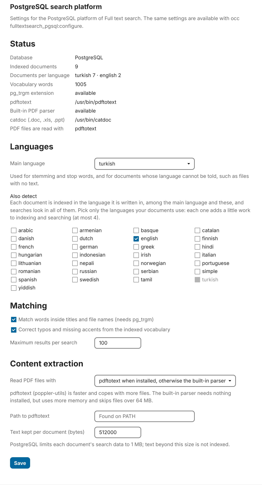

# Full Text Search - PostgreSQL

A search platform for Nextcloud's [Full Text Search](https://github.com/nextcloud/fulltextsearch) that uses PostgreSQL's built-in full-text search instead of Elasticsearch. If Nextcloud already runs on PostgreSQL, there is nothing else to install or operate.

## Features

- **Ranked results with excerpts.** Title matches outrank tags, which outrank comments and other document parts, which outrank body text. Excerpts come from `ts_headline`.
- **Rare words count more.** In a search with several words, each word is weighted by how few of the documents you can see contain it (BM25's inverse document frequency), so `invoice kırklareli` puts the few documents mentioning *Kırklareli* ahead of the many that only mention invoices. Documents containing every word still come first.
- **Search-as-you-type.** Words match as prefixes: `rap` finds *rapor*, *raporlar*.
- **File names are split into words.** `final`, `2025` or `final.pdf` all find *rapor_2025_final.pdf*; `img` finds *IMG20250412.jpg*. PostgreSQL would otherwise treat each file name as a single word.
- **Substring matching in titles.** A word of three or more letters also matches anywhere inside a title: `butce` finds *YillikButceRaporu.xlsx*. These matches rank below normal word matches. Needs `pg_trgm`.
- **Query syntax** (the Full Text Search framework's standard, same as the Elasticsearch platform): plain words are optional and any of them can match, `+word` is required, `-word` is excluded, `"exact phrase"` works with or without `+`/`-`. Documents containing every word are always listed before partial matches. Queries made only of exclusions or stopwords return nothing rather than everything.
- **Diacritics optional.** `calisma` finds *çalışma*, `sozlesme` finds *sözleşme*, and the other way round, from a vocabulary of every indexed word.
- **Typo correction.** Misspelled words are corrected against the same vocabulary, including swapped letters: `recieve` finds *receive*, `rpaor` finds *rapor*. The original word is still searched too, so nothing that matched before is lost. Needs `pg_trgm`. If nothing matches at all, titles are also searched by similarity.
- **Any language your PostgreSQL ships**, including Turkish, with correct dotted/dotless I handling (see below).
- **Several languages at once.** With `turkish,english`, each document is indexed with the stemming of the language it is written in, detected from its stop words, and every search looks in all configured languages.
- **Access control.** Users only see documents they own or that are shared with them, their groups, or their teams (circles).
- **Text extraction** for plain text (UTF-8, UTF-16, legacy Windows-1254), OpenDocument and Office Open XML files (odt/ods/odp, docx/xlsx/pptx and their macro-enabled and template variants), Office 97–2003 files (doc/xls/ppt) when `catdoc` is installed, and PDFs: with `pdftotext` when it is installed, with a bundled pure-PHP parser otherwise.
- **Partial updates.** When only metadata changes (a new share, a rename), the stored text is kept instead of being re-extracted.

## Requirements

- Nextcloud 29–35 running on **PostgreSQL 12 or newer**
- The **Full Text Search** app plus at least one content provider, e.g. **Full Text Search - Files**
- The PHP version your Nextcloud release requires (8.1+ for Nextcloud 29, 8.3+ for 35), with `zip` for office documents
- Optional: `catdoc` for Office 97–2003 files (`apt install catdoc`; it provides `catdoc`, `xls2csv` and `catppt`). Without it, `.doc`, `.xls` and `.ppt` files are indexed by name only.
- Recommended: `poppler-utils` for faster, more robust PDF text (`apt install poppler-utils`). Without it, a bundled parser ([smalot/pdfparser](https://github.com/smalot/pdfparser)) reads PDFs in PHP.
- Optional: the `pg_trgm` extension for typo tolerance. Since PostgreSQL 13 it is a trusted extension and the app creates it automatically when the Nextcloud database user owns the database. Otherwise a superuser can run `CREATE EXTENSION pg_trgm;` in the Nextcloud database.

## Installation

From the App Store (once the first release is published there): **Apps → Search → Full Text Search - PostgreSQL**, or

```bash
sudo -u www-data php /var/www/nextcloud/occ app:install fulltextsearch_pgsql
```

From source:

```bash
cd /var/www/nextcloud/apps
git clone https://github.com/surfcu/fulltextsearch_pgsql.git
cd fulltextsearch_pgsql
composer install --no-dev --ignore-platform-req=php   # builds the bundled PDF parser in lib/Vendor
sudo -u www-data php /var/www/nextcloud/occ app:enable fulltextsearch_pgsql
```

`composer install` only matters for PDFs on servers without `pdftotext`: without it the app still works, and PDFs need `pdftotext`. App Store archives already include the parser. `--ignore-platform-req=php` keeps the dev tools' PHP limits from blocking the install; none of them are installed.

For text from old Office files and faster PDFs, install the optional tools:

```bash
sudo apt install poppler-utils catdoc
```

For typo correction and title substrings, the Nextcloud database user should own the database, as in [Nextcloud's PostgreSQL setup](https://docs.nextcloud.com/server/latest/admin_manual/configuration_database/linux_database_configuration.html). The app can then enable `pg_trgm` itself on PostgreSQL 13+.

Then choose it as the platform and build the index:

```bash
occ fulltextsearch:configure '{"search_platform":"OCA\\FullTextSearch_PgSql\\Platform\\PostgreSQLPlatform"}'
occ fulltextsearch_pgsql:configure '{"language":"english"}'   # or turkish, turkish,english, simple, ...
occ fulltextsearch:test
occ fulltextsearch:index
```

The platform can also be picked in **Administration settings → Full text search**.

Keep the index current with the live indexer (`occ fulltextsearch:live`, e.g. as a systemd service) or the framework's cron job.

## Configuration

Administrators can change every setting in **Administration settings → Full text search**, under *PostgreSQL search platform*. The panel also shows whether `pg_trgm`, `pdftotext` and `catdoc` are available, which tool reads PDFs, and how many documents are indexed in each language.

<p align="center"></p>

The same settings are available from the command line:

```bash
occ fulltextsearch_pgsql:configure                 # show current settings
occ fulltextsearch_pgsql:configure --languages     # languages this PostgreSQL server supports
occ fulltextsearch_pgsql:configure '{"language":"turkish","max_content_size":800000}'
occ fulltextsearch_pgsql:configure '{"language":"turkish,english"}'   # several languages, first is the fallback
```

| Setting | Default | Meaning |
|---|---|---|
| `language` | `english` | PostgreSQL text search configuration used for stemming and stopwords, or several separated by commas (at most 5), e.g. `turkish,english`. Each must be listed by `--languages`. With several, each document is indexed in the one it is written in and searches look in all of them; the first is used for documents whose language cannot be told. Use `simple` for no stemming at all. |
| `use_trigram` | `true` | Substring matching in titles, spelling correction, and similarity matching on titles when a search has no results. Ignored if `pg_trgm` is unavailable. |
| `typo_correction` | `true` | Accent variants and spelling corrections from the vocabulary of indexed words. Accent variants work without `pg_trgm`. |
| `max_results` | `100` | Upper limit for the page size a client may request. |
| `max_content_size` | `512000` | Bytes of extracted text indexed per document. Larger documents are truncated. PostgreSQL rejects search vectors over 1 MB; if a document still exceeds that it is indexed by title and metadata only, with a warning. |
| `pdftotext_path` | *(empty)* | Path to `pdftotext`. Empty means look it up on `PATH`. |
| `pdf_extractor` | `auto` | `auto`: `pdftotext` when found, otherwise the bundled parser (also used when `pdftotext` fails to run). `pdftotext`: never fall back. `pdfparser`: always use the bundled parser. |

The configure command and the admin panel validate every value before saving any. `occ config:app:set` works too but does not validate.

### Typo correction vocabulary

Words are collected as documents are indexed. Indexes built before version 1.3.0 have no vocabulary yet: on upgrade it is filled automatically for up to 10,000 documents; for larger indexes, or to drop words from deleted documents, run:

```bash
occ fulltextsearch_pgsql:vocabulary            # show the number of words
occ fulltextsearch_pgsql:vocabulary --rebuild  # rebuild from the index (about 1.5 ms per document)
```

### Several languages

With more than one language, each document's language is detected when its content is indexed: the app samples the first 2,000 characters and counts, for each configured language, the words PostgreSQL's dictionary for that language treats as stop words (*ve*, *için*, *the*, *which*, *und*…). The language with clearly the most is used; titles, file names and short texts with no stop words get the first language. When only a document's metadata changes (a new share), its language is kept.

Searches run once per configured language, each against the documents indexed in it, in a single query. Pick only the languages your documents are written in: each adds a few milliseconds to indexing a document and a branch to every search.

**After changing `language`, rebuild the index** so existing documents are processed with it:

```bash
occ fulltextsearch:reset && occ fulltextsearch:index
```

## Upgrading

Nextcloud runs the app's repair step on upgrade; the index table and its documents are kept. Some improvements only apply to documents indexed after them:

- **Office text extraction** (words split across formatting runs, spreadsheet numbers, comments, text boxes) and **Office 97–2003 files** — re-index office documents.
- **Several languages** — documents keep the language they were indexed in until re-indexed.

To re-index everything:

```bash
occ fulltextsearch:reset && occ fulltextsearch:index
```

See [CHANGELOG.md](CHANGELOG.md) for what changed in each version.

## Turkish

PostgreSQL lowercases text using the database's locale, which is rarely `tr_TR`. Under any other locale `I` becomes `i` instead of `ı`, so `ISPARTA` would never match `ısparta` and uppercase words would miss their lowercase forms. When `language` is `turkish`, the app maps `I→ı` and `İ→i` before stemming, both when indexing and when searching, so it works regardless of the database locale.

A Turkish-language guide is in [docs/TURKISH.md](docs/TURKISH.md).

## What gets indexed from files

| Content | How |
|---|---|
| Text files (txt, md, csv, code, …) | Decoded directly; UTF-8, UTF-16 with BOM, or Windows-1254 |
| OpenDocument (odt, ods, odp) | `content.xml`: text, tables, notes, comments; deleted tracked changes left out |
| Office Open XML (docx, xlsx, pptx) | Word: body, headers and footers, footnotes, comments, text boxes. Excel: cell text and numbers, formula results, sheet names, comments, text boxes. PowerPoint: slides, speaker notes, comments. SmartArt in all three. Deleted tracked changes, field codes and formulas are left out; a word split across formatting runs stays one word. At most 32 MB of each part is read. |
| Office 97–2003 (doc, xls, ppt) | `catdoc`, `xls2csv` or `catppt` if installed. Recent PowerPoint versions save `.ppt` files `catppt` cannot always read. Password-protected files are indexed by name only. |
| PDF | `pdftotext` if installed (60 s timeout per file), otherwise the bundled parser (files up to 64 MB, and only when `memory_limit` leaves about 12× the file size free) |
| Scanned PDFs, images, other binaries | Title, tags and comments only; logged as a warning |

Which files are sent for indexing at all (size limits, external storage, etc.) is decided by the Files provider's own settings.

## Limitations

- Ranking is good but simpler than Elasticsearch's BM25; there are no synonyms or per-field boosting knobs.
- Each document is indexed in one language. A document mixing two languages gets the one with more stop words in its first 2,000 characters; words in the other are still found, without that language's stemming. Documents keep the language they were indexed with until they are reindexed.
- No OCR. Office 97–2003 files need `catdoc`.
- Excerpts are generated from at most `max_content_size` bytes of each document.
- Corrections are applied silently: the Full Text Search interface has no place for a "did you mean …" hint.
- Only words of three letters or more get accent variants, and four or more get spelling corrections. Spelling correction only kicks in for words that appear nowhere in the index.
- Everything lives in your Nextcloud database, so index size counts toward its storage and backups (roughly 1–2× the extracted text).

## How it works

See [docs/ARCHITECTURE.md](docs/ARCHITECTURE.md). In short: one table, `ftspg_<prefix>index` (e.g. `ftspg_oc_index`), with a generated weighted `tsvector` column, GIN indexes on it and on an access-token array, and a trigram index on a lowercased copy of the title. The table is deliberately named outside Nextcloud's table prefix so Nextcloud's Doctrine schema tooling never sees its PostgreSQL-specific column types.

Coming from Elasticsearch? See [docs/MIGRATION.md](docs/MIGRATION.md).

## Troubleshooting

**`occ fulltextsearch:test` fails.** Check `nextcloud.log`. The platform requires Nextcloud's own database to be PostgreSQL; it cannot use a separate PostgreSQL server.

**No substring matching or spelling correction.** `occ fulltextsearch_pgsql:configure` shows the setting; `occ fulltextsearch:check` shows `"pg_trgm": false` if the extension is missing. Create it as a superuser, then run `occ fulltextsearch:test`, which adds the trigram index.

**PDFs have no content.** The indexing warning says why. `occ fulltextsearch:check` shows `pdf_tool`, the tool PDFs currently go through. The bundled parser skips large files, files it cannot parse and encrypted ones; installing `poppler-utils` handles more of them. Scanned PDFs contain images, not text.

**Office documents have no content.** The indexing warning says why. `.doc`, `.xls` and `.ppt` files need `catdoc` (`occ fulltextsearch:check` shows `"catdoc"`); password-protected files cannot be read. For `.docx`, `.xlsx` and `.pptx` indexed before this version, re-index (see [Upgrading](#upgrading)).

**A document was indexed in the wrong language.** Detection needs a sentence or two of running text in one of the configured languages; titles, lists of names and numbers, and very short texts fall back to the first language. `SELECT document_id, config FROM ftspg_oc_index;` shows each document's language. Make sure the language is configured, then re-index.

**Slow searches on very large instances.** Run `ANALYZE ftspg_oc_index;` after the initial index and make sure `shared_buffers` and `work_mem` are sized for your data. Very short prefixes (one or two letters) match many words and are inherently slower.

## Development

```bash
composer install          # nextcloud/ocp stubs and Psalm; also builds lib/Vendor (see below)
composer psalm            # static analysis against the real Nextcloud interfaces
composer cs:check         # Nextcloud coding standard (composer cs:fix applies it)
FTSPG_TEST_DSN="pgsql:host=localhost;dbname=fts_test;user=postgres;password=postgres" composer test
```

The integration tests run against a real, disposable PostgreSQL database with a UTF-8 locale (Turkish lowercasing depends on it). With `poppler-utils` and `catdoc` installed they also extract real PDF and Office 97–2003 files; without them, they check the warnings instead. The Office 97–2003 samples in `tests/fixtures` come from Apache Tika (Apache-2.0) and are not part of the app archive. CI runs Psalm against the Nextcloud 30, 34 and 35 APIs, checks the coding standard, and the integration tests on PHP 8.1 through 8.5 with PostgreSQL 13 and 17.

`tests/live/run.sh` goes further: CI installs real Nextcloud 30, 34 and 35 servers on PostgreSQL with Full Text Search and the Files provider, runs the framework's own `occ fulltextsearch:test`, then indexes and searches real files: text, Office documents (including a word split across formatting runs and a Word 97–2003 file), and PDFs through both `pdftotext` and the bundled parser. It also indexes English and Turkish documents side by side with two languages configured, checks that nothing from the app reaches `nextcloud.log` as a warning or error, and covers both a database the Nextcloud user owns (`pg_trgm` enabled by the app) and one it doesn't (trigram features off).

The bundled PDF parser lives in `lib/Vendor`, generated by `scripts/scope-pdfparser.php` from `vendor/smalot/pdfparser` with its namespace rewritten to `OCA\FullTextSearch_PgSql\Vendor\Smalot\PdfParser`. That keeps it separate from any other app's copy and lets Nextcloud autoload it from `lib/` without Composer at runtime. `composer install` and `make appstore` regenerate it; it is not committed.

Releases are built and published to the Nextcloud App Store from GitHub; see [docs/RELEASING.md](docs/RELEASING.md). To check against a specific Nextcloud release, install its API stubs first: `composer require --dev nextcloud/ocp:dev-stable35`.

## License

AGPL-3.0-or-later
